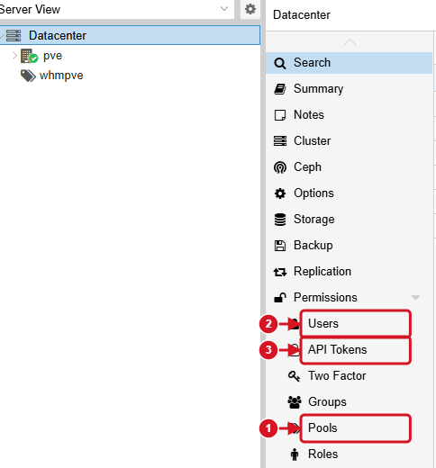
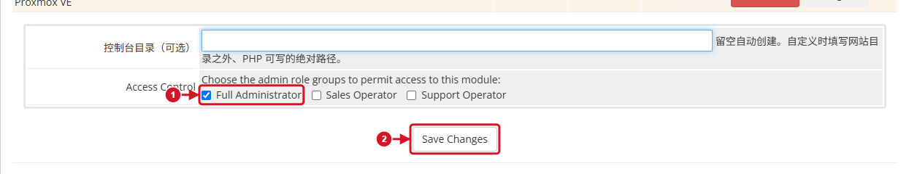
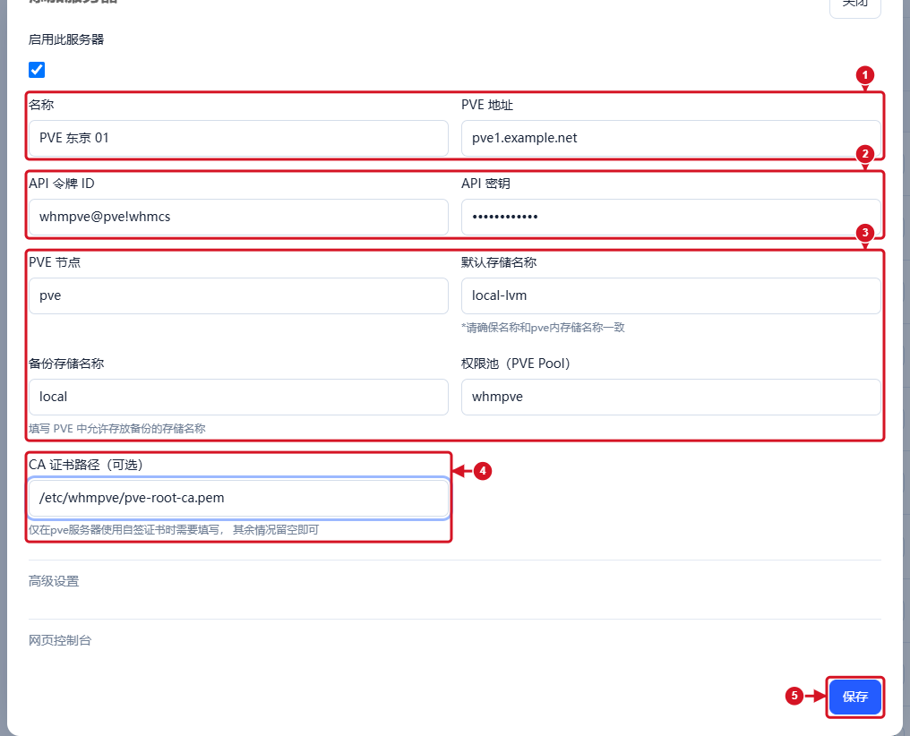
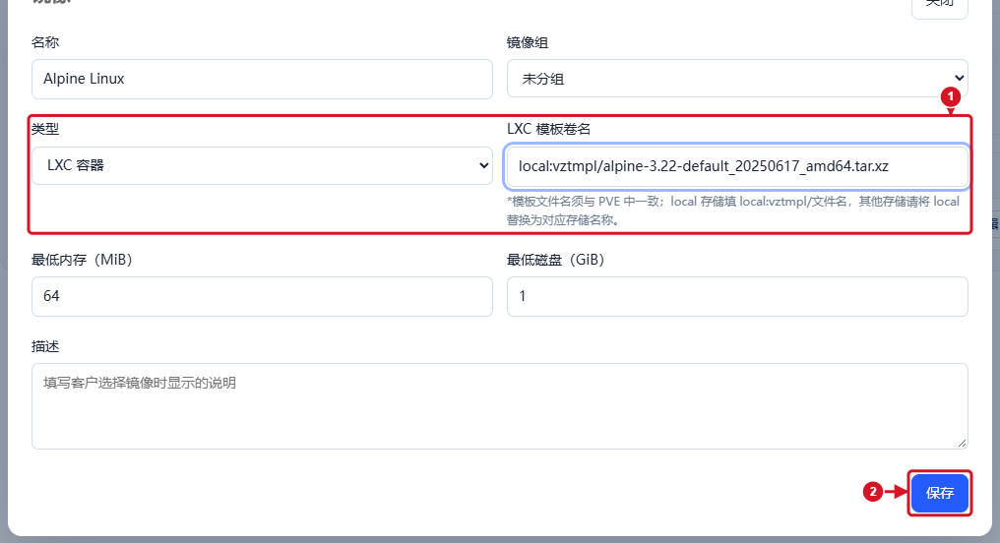
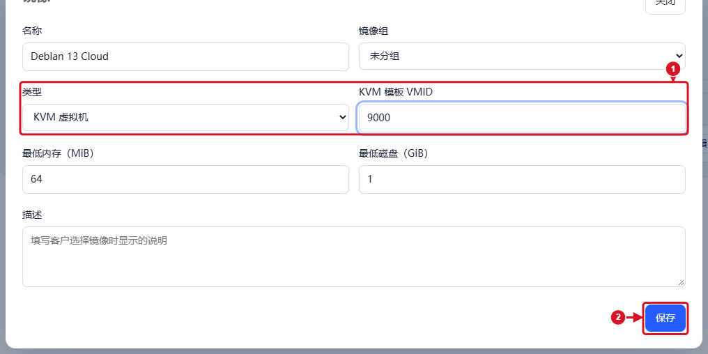
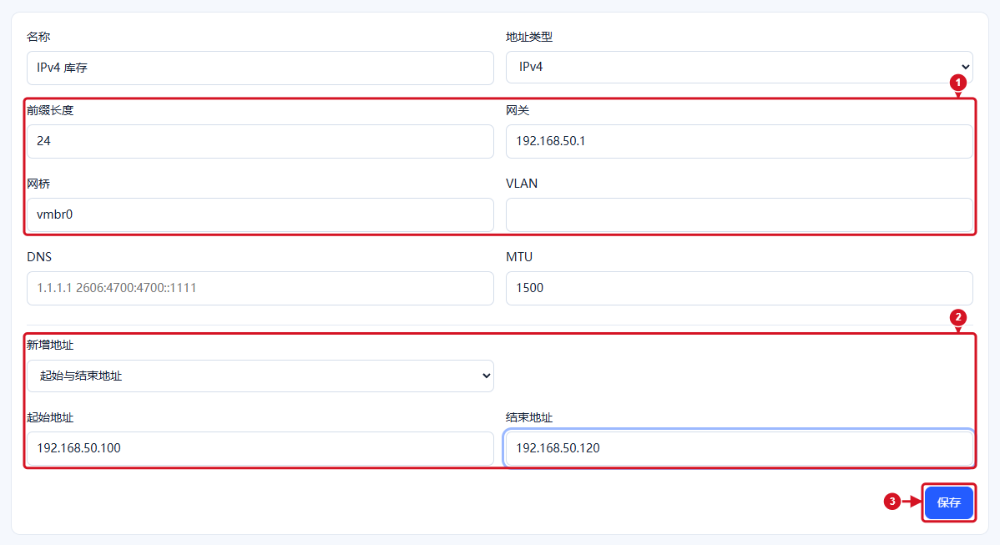
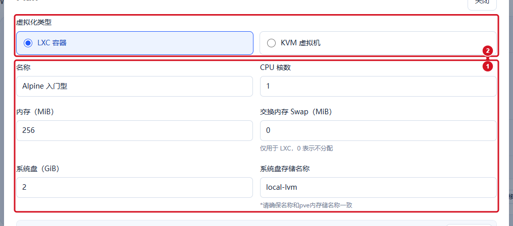
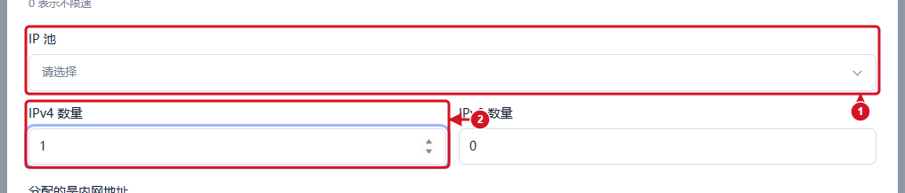
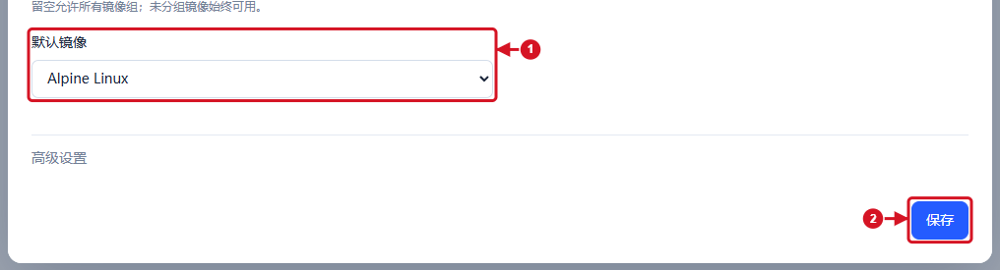
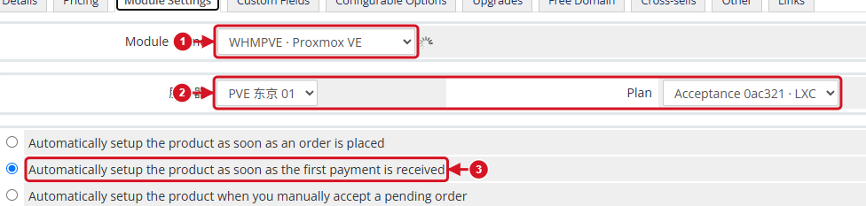

# WHMPVE 完整部署教程

从已安装的 WHMCS 和 PVE 开始，两边都用管理员账号操作。示例使用一个 PVE 节点、一个 IPv4 地址池和一个 Alpine LXC 产品。需要销售 KVM 时，按第 3 步的 KVM 小节准备镜像，再为 KVM 单独建 Plan 和产品。

## 1. 在 PVE 确认网桥和存储

1. 进入「节点 → 系统 → 网络」，确认实例要用的 Linux 网桥，例如 `vmbr0`。准备该网桥上可分配的空闲 IP、前缀长度和网关。若使用管理网桥测试，请先把这段地址从路由器的 DHCP 分配范围排除。
2. 在「数据中心 → 存储」确认 `local` 允许保存「容器模板」和「备份」。默认分区安装通常用 `local-lvm` 保存「容器」和「磁盘映像」。没有 `local-lvm` 时，选择支持对应内容类型且有空余空间的存储。


## 2. 创建 PVE 资源池、用户和 API 令牌

1. 在「数据中心 → 权限 → 资源池」点「创建」，池 ID 填 `whmpve`。
2. 在「数据中心 → 权限 → 用户」点「添加」。用户名填 `whmpve`，认证域选「Proxmox VE authentication server」，设置密码。
3. 在「数据中心 → 权限 → API 令牌」点「添加」。用户选 `whmpve@pve`，令牌 ID 填 `whmcs`，保留「权限分离」。保存完整令牌 ID `whmpve@pve!whmcs` 和弹窗里的密钥。



4. 在 PVE 的 Shell 以管理员身份执行以下命令，将权限同时授予用户及启用了权限分离的令牌。使用不同池名时，替换 `/pool/whmpve`。示例将存储和网络权限授予整个路径。

```sh
for entry in "/ PVEAuditor" "/pool/whmpve PVEVMAdmin,PVEPoolAdmin" "/storage PVEDatastoreUser" "/sdn/zones PVESDNUser"; do
    path=${entry% *}
    roles=${entry#* }
    pveum acl modify "$path" --users whmpve@pve --roles "$roles"
    pveum acl modify "$path" --tokens 'whmpve@pve!whmcs' --roles "$roles"
done
```

5. 若 PVE 使用默认签发的证书，将 PVE 上的 **`/etc/pve/pve-root-ca.pem`** 复制到 **WHMCS 主机**的 `/etc/whmpve/pve-root-ca.pem`。让网站 PHP 和 WHMCS Cron 的运行用户可读。记录与 PVE 证书匹配、能从 WHMCS 主机解析的 PVE 主机名，例如 `pve1.example.net`。 [Proxmox VE 权限文档](https://github.com/proxmox/pve-docs/blob/master/pveum.adoc)

## 3. 在 PVE 准备镜像

### LXC 容器

1. 打开「节点 → local → CT Templates（容器模板）」，点「Templates（模板）」。
2. 搜索 `alpine`，选一条与节点匹配的模板，点「Download（下载）」。记下下载后的完整文件名。
3. 在下文的 WHMPVE 镜像表单中，把卷名填成 `local:vztmpl/完整文件名`。模板放在其他存储时，替换冒号前的 `local`。


### KVM 虚拟机

1. 在支持 KVM 的 PVE 节点下载所选系统的 Cloud-Init 镜像。下例使用 Debian 13 的 amd64 云镜像，先把它放到 PVE 节点的 `/var/tmp/debian-13-genericcloud-amd64.qcow2`。核对镜像发布方提供的校验值。 [Debian 官方云镜像](https://cloud.debian.org/images/cloud/trixie/latest/)
2. 在 PVE Shell 执行以下命令。用空闲 VMID 替换 `9000`，按需替换 `vmbr0` 和 `local-lvm`。

```sh
qm create 9000 --name debian-13-cloud --memory 1024 --net0 virtio,bridge=vmbr0 --scsihw virtio-scsi-pci
qm set 9000 --scsi0 local-lvm:0,import-from=/var/tmp/debian-13-genericcloud-amd64.qcow2
qm set 9000 --ide2 local-lvm:cloudinit --boot order=scsi0 --serial0 socket --agent enabled=1
qm template 9000
```

3. 将模板的克隆权限分别授予用户和令牌。每个 KVM 模板执行一次。

```sh
pveum acl modify /vms/9000 --users whmpve@pve --roles PVETemplateUser
pveum acl modify /vms/9000 --tokens 'whmpve@pve!whmcs' --roles PVETemplateUser
```

4. 记下 PVE 左侧模板条目中显示的 VMID，例如 `9000`。KVM Plan 的系统盘不能小于模板磁盘。需要使用 KVM 数据盘自动挂载或客户区重置密码时，制作模板前先在镜像中安装并启用 `qemu-guest-agent`。Debian 镜像的数据盘还需安装 `util-linux`、`fdisk`、`mount`、`e2fsprogs` 和 `coreutils`。 [Proxmox Cloud-Init 文档](https://github.com/proxmox/pve-docs/blob/master/qm-cloud-init.adoc)


## 4. 安装并启用 WHMPVE

1. 解压 WHMPVE 安装包，把 `modules/` 和 `includes/` 合并到 WHMCS 根目录，也就是 `configuration.php` 所在的目录。确认下面三个文件已上传。

   ```text
   modules/addons/whmpve_manager/whmpve_manager.php
   modules/servers/whmpve/whmpve.php
   includes/hooks/whmpve.php
   ```

2. 进入「配置 → 系统设置 → 附加模块」，在 WHMPVE 一行点「启用（Activate）」。点击「配置（Configure）」，勾选允许使用的管理员角色，例如「Full Administrator」，保存。 [WHMCS 启用附加模块](https://docs.whmcs.com/9-1/addon-modules/addon-modules/#activate-an-addon-module)




3. 进入「系统设置 → 自动化设置（Automation Settings）」，复制页面顶部给出的 Cron 命令。用站点兼容的 PHP CLI，以站点运行用户每 5 分钟执行一次。已有 WHMCS Cron 时，在「自动化状态」确认它近期正常运行。 [WHMCS Cron 设置](https://docs.whmcs.com/9-1/system/automation/system-cron/)


## 5. 在 WHMPVE 添加服务器

1. 打开「附加模块 → WHMPVE → 服务器」，点「添加服务器」。


2. 填写下表并保存，然后在该服务器一行点「检测」，确认返回 PVE 版本和节点。

| 字段 | 示例 |
| --- | --- |
| 名称 | `PVE 东京 01` |
| PVE 地址 | `pve1.example.net`，只填主机名 |
| API 令牌 ID / API 密钥 | `whmpve@pve!whmcs` / 生成令牌时保存的密钥 |
| PVE 节点 | `pve`，按 PVE 左侧节点名称填写 |
| 默认存储名称 / 备份存储名称 | `local-lvm` / `local` |
| 权限池（PVE Pool） | `whmpve` |
| CA 证书路径（可选） | PVE 使用默认签发证书时填 `/etc/whmpve/pve-root-ca.pem` |

PVE API 使用其他端口时，在「高级设置」修改「API 端口」。




## 6. 添加镜像和 IP 池

1. 点服务器名称进入配置，再点「镜像 → 添加镜像」。填客户看到的名称、类型和第 3 步记录的卷名或 KVM 模板 VMID，设置最低内存和磁盘，保存。





2. 进入「IP 池 → 创建 IP 池」。选 IPv4，填前缀长度、网关、网桥和 DNS。把「新增地址」选为「起始与结束地址」，填可用地址的起止值并保存。配图里的地址用于示例，换成你在第 1 步准备的地址。



添加零散地址时选「手动添加」，每行一条。需要 IPv6 时另建一池，选择「生成 IPv6」，填写可分配的前缀和地址数量。

## 7. 创建 Plan

1. 在该服务器的「Plan」页点「新建 Plan」。选镜像对应的虚拟化类型，填写核数、内存、系统盘大小和 PVE 存储名。Alpine 测试可以用 1 核、256 MiB、2 GiB。



2. 选择刚创建的 IP 池，将「IPv4 数量」填 `1`、「IPv6 数量」填 `0`。在表单底部选择刚添加的默认镜像并保存。





3. 按需填带宽和月流量额度，填 `0` 为不限。需要备份时，设置「最多备份数」。允许客户自行开自动备份时，勾选「允许客户启用自动备份」。

## 8. 创建 WHMCS 产品并验证开通

1. 打开「系统设置 → 产品/服务」。首次创建时先点「创建新组（Create a New Group）」，再点「创建新产品（Create a New Product）」。类型选「Server/VPS」，填写产品名称并选择该组。


2. 在「定价」设置金额和账期。在「模块设置（Module Settings）」选择 `WHMPVE`，再选刚创建的服务器和 Plan。测试自动开通时，选「收到首笔付款后自动开通」，保存更改。



3. 使用已启用的支付方式创建一笔测试订单并完成支付。需要测试线下入账时，可在 WHMCS 启用「Bank Transfer」，用测试客户下单，再在对应账单点「Add Payment」登记测试付款。
4. 打开「附加模块 → WHMPVE → 日志/任务」确认开通成功，再到「实例管理」点击「管理」。在 PVE 核对这台实例的运行状态、IP 和磁盘。用测试客户账号打开服务详情，检查电源操作和任务状态。


## 9. 按需开启网页控制台

任选一份部署指南。

- [Python 网页控制台中继](console-python.md)
- [Nginx 网页控制台中继](console-nginx.md)
- [Apache2 网页控制台中继](console-apache2.md)
