# WHMPVE 完整部署教程

从已安装的 WHMCS 和 PVE 开始，两边都用管理员账号操作。示例使用一个 PVE 节点和一个 Alpine LXC 产品。网络可以用 IPv4 NAT、OVHcloud 公网 IPv6，或同时配置两者。需要销售 KVM 时，按第 3 步准备镜像，再为 KVM 单独建 Plan 和产品。

## 1. 在 PVE 配置网络和存储

### 在 PVE 界面创建 VPS 网桥

本例使用 `vmbr0` 接公网，新增一个 `vmbr1` 接 VPS。`vmbr1` 是 PVE 上的 **Linux Bridge（Linux 网桥）**，相当于 VPS 连接的一台虚拟交换机。示例公网地址 `203.0.113.10` 和 `2001:db8:1234:5678::/64` 都要换成自己的地址。应用网络配置前，先准备好能从机房面板打开的宿主机控制台。 [PVE 网络配置](https://github.com/proxmox/pve-docs/blob/master/pve-network.adoc)

1. 登录 PVE，点击左侧树里的**节点名称**（图中为 `pve`），展开「系统」，点击「网络」。英文界面对应「System → Network」。

   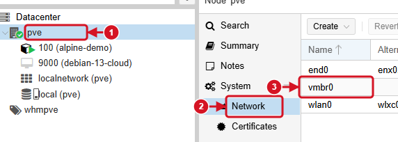

2. 在网络列表看「名称」「端口/从属」「CIDR」和「网关」。本例的公网 IPv4 在 `vmbr0` 行，该网桥的端口是 `eno1`，所以后续命令中的公网接口填 `vmbr0`。如果公网 IP 配在 `eno1` 等物理网卡上，后续命令填实际网卡名。保留已有公网接口的地址、端口和网关。

   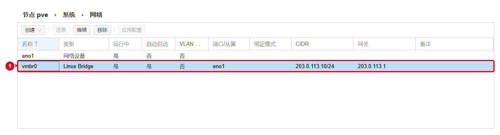

3. 点网络列表上方的「创建」，在菜单里选 **Linux Bridge**。如果已有专供这批 VPS 使用、且和下表配置一致的网桥，可以直接使用。如果 `vmbr1` 已用于其他网络，选择一个空闲的网桥编号，并统一替换本教程里的 `vmbr1`。

   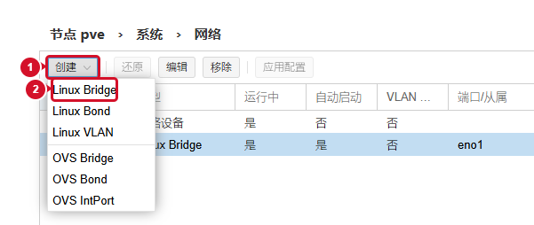

4. 按表填新网桥的字段，然后点弹窗右下角的「创建」。双栈按 **IPv4 NAT／双栈** 这一列填，IPv6 的网关地址和路由随后在 Shell 添加。

   | PVE 弹窗字段 | IPv4 NAT／双栈 | 仅公网 IPv6 |
   | --- | --- | --- |
   | 名称 | `vmbr1` | `vmbr1` |
   | IPv4/CIDR | `10.0.1.1/24` | 留空 |
   | 网关（IPv4） | 留空 | 留空 |
   | IPv6/CIDR | 留空 | 留空 |
   | 网关（IPv6） | 留空 | 留空 |
   | 自动启动 | 勾选 | 勾选 |
   | VLAN 感知 | 不勾选 | 不勾选 |
   | 网桥端口 | 留空，PVE 会写成 `bridge-ports none` | 留空 |
   | 备注 | 可留空 | 可留空 |
   | MTU（高级） | 默认 `1500` | 默认 `1500` |

   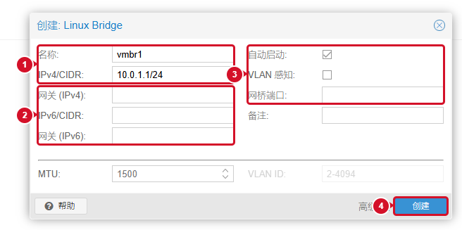

   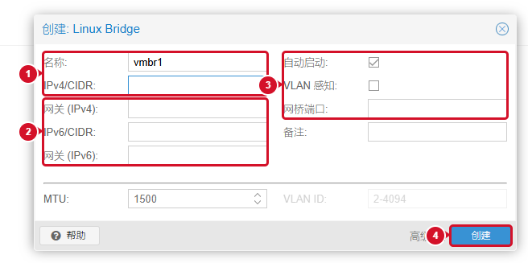

5. 回到网络列表，确认出现 `vmbr1`，底部的「待应用的更改」里只有刚才设置的改动。点工具栏的「应用配置」，在弹窗点「是（Yes）」。任务完成后，确认 `vmbr1` 的类型为 Linux Bridge，「运行中」为「是」。先做完这一步，再到 Shell 添加转发命令。 [PVE 应用网络配置](https://github.com/proxmox/pve-docs/blob/master/pve-network.adoc#sysadmin_network_configuration)

   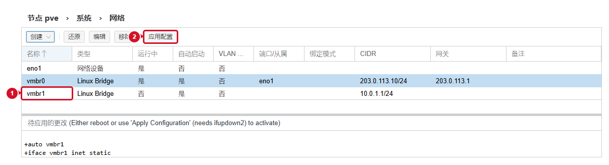

   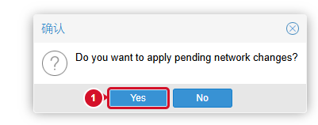

   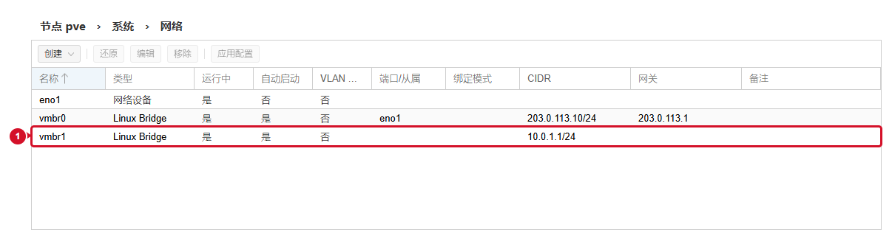

### 单公网 IPv4 与 NAT 转发

下列宿主机命令在 PVE 节点的 Shell 里用 `root` 执行。

1. 在 PVE 宿主机的 Shell 运行 `nano /usr/local/sbin/whmpve-nat4`，把下面内容粘进去。把 `wan` 和 `public_ip` 改成上一步记下的公网接口及实际公网 IPv4。按 `Ctrl+O`、回车保存，按 `Ctrl+X` 退出。示例给 `10.0.1.2` 到 `10.0.1.10` 配置出站和入站。扩大 IPv4 池时，一并修改 `seq 2 10` 的范围，使用 `.2` 到 `.254`，并避开宿主机已经在用的公网端口。

   ```sh
   #!/bin/sh
   set -eu
   wan=vmbr0
   lan=vmbr1
   public_ip=203.0.113.10
   subnet=10.0.1.0/24
   sysctl -q -w net.ipv4.ip_forward=1

   add_rule() {
       table=$1
       chain=$2
       shift 2
       iptables -w -t "$table" -C "$chain" "$@" 2>/dev/null ||
           iptables -w -t "$table" -A "$chain" "$@"
   }

   add_rule nat POSTROUTING -s "$subnet" -o "$wan" -j SNAT --to-source "$public_ip"
   add_rule filter FORWARD -i "$lan" -o "$wan" -s "$subnet" -j ACCEPT
   add_rule filter FORWARD -i "$wan" -o "$lan" -d "$subnet" -m conntrack --ctstate ESTABLISHED,RELATED -j ACCEPT
   add_rule filter FORWARD -i "$wan" -o "$lan" -d "$subnet" -m conntrack --ctstate DNAT --ctorigdst "$public_ip" -j ACCEPT

   for last in $(seq 2 10); do
       guest_ip="10.0.1.$last"
       ssh_port=$((61000 + last))
       first=$((10000 + last * 10))
       add_rule nat PREROUTING -i "$wan" -d "$public_ip" -p tcp --dport "$ssh_port" -j DNAT --to-destination "$guest_ip:22"
       for proto in tcp udp; do
           add_rule nat PREROUTING -i "$wan" -d "$public_ip" -p "$proto" --dport "$first:$((first + 9))" -j DNAT --to-destination "$guest_ip"
       done
   done
   ```

   规则沿用 `addnat.sh` 的端口分配。原脚本会清空宿主机 NAT 表，且接口名写死为 `eno1` 和 `br0`，本例请使用上面的规则。 [addnat.sh](https://github.com/hajidishu/addnat.sh/blob/main/addnat.sh) · [PVE NAT 文档](https://github.com/proxmox/pve-docs/blob/master/pve-network.adoc#sysadmin_network_masquerading)

2. 执行 `chmod 0755 /usr/local/sbin/whmpve-nat4`，再运行 `nano /etc/network/interfaces`。找到界面刚生成的 `iface vmbr1 inet static`，在该段后面添加下面的 `post-up` 行。整段配置可对照下例，文件里只保留一段 `vmbr1` 的 IPv4 配置。保存后执行 `ifreload -a`，再执行 `/usr/local/sbin/whmpve-nat4` 让规则立即生效。`post-up` 会在下次网桥启动时加载规则。

   ```text
   auto vmbr1
   iface vmbr1 inet static
       address 10.0.1.1/24
       bridge-ports none
       bridge-stp off
       bridge-fd 0
       post-up /usr/local/sbin/whmpve-nat4
   ```

3. 使用宿主机或 PVE 防火墙时，放行 `vmbr1` 的 IPv4 出站转发、回包，以及指向 `vmbr1` 的这批 DNAT 端口。规则需放在拒绝规则之前。使用传统 PVE 防火墙且出站 NAT 失败时，按官方文档检查 `fwbr+` 的连接跟踪区域。 [PVE NAT 与防火墙](https://github.com/proxmox/pve-docs/blob/master/pve-network.adoc#sysadmin_network_masquerading)

### OVHcloud `/64` 中的公网 IPv6 `/128`

1. 登录 OVHcloud 控制面板，打开「Bare Metal Cloud → Dedicated servers」，点你的服务器。在「General information（常规信息）」标签找到「Network（网络）」区域，复制 **IPv6 地址或网段**和 **IPv6 网关**。看到单个 `/128` 时，先确认实际获配的网段，再决定能否从 `/64` 里分配地址。OVHcloud 也有只提供一个 `/128` 的机型。示例网段为 `2001:db8:1234:5678::/64`，宿主机地址为 `2001:db8:1234:5678::1`，第一台 VPS 用 `2001:db8:1234:5678::103/128`。 [OVHcloud 裸金属 IPv6 配置](https://docs.ovhcloud.com/en/guides/bare-metal-cloud/dedicated-servers/network-ipv6)

   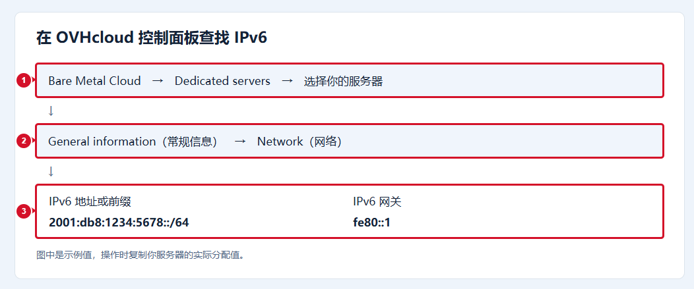

2. 先确认宿主机的公网 IPv6 和默认路由正常。需要补配时，在 `/etc/network/interfaces` 为 `vmbr0` 添加下列 IPv6 段，已有 IPv6 段时按实际配置调整。示例上游网关是 `fe80::1`，若 OVHcloud 给的是公网 IPv6 网关，把两条路由里的 `fe80::1` 都换成面板给的地址。

   ```text
   iface vmbr0 inet6 static
       address 2001:db8:1234:5678::1/128
       post-up ip -6 route replace fe80::1/128 dev vmbr0
       post-up ip -6 route replace default via fe80::1 dev vmbr0
   ```

   保存后执行 `ifreload -a`。运行 `ip -6 route show default`，确认默认路由走公网接口，再运行 `ping -6 -c 3 2606:4700:4700::1111` 验证宿主机能用 IPv6 联网。

3. 运行 `nano /etc/network/interfaces`，找到界面已创建的 `vmbr1`。双栈时找到 `iface vmbr1 inet static`，仅 IPv6 时找到 `iface vmbr1 inet manual`。把下面的行添加到该段结尾。每增加一个客户地址，为它复制一行 `/128` 路由、一行 Proxy NDP 和对应的 `post-down`，并换成要分配的地址。在 IP 池中只添加已配置的地址。保存并执行 `ifreload -a`。

   ```text
       post-up sysctl -q -w net.ipv6.conf.all.forwarding=1
       post-up sysctl -q -w net.ipv6.conf.vmbr0.proxy_ndp=1
       post-up ip -6 addr replace fe80::10/64 dev vmbr1
       post-up ip -6 route replace 2001:db8:1234:5678::103/128 dev vmbr1
       post-up ip -6 neigh replace proxy 2001:db8:1234:5678::103 dev vmbr0
       post-down ip -6 neigh del proxy 2001:db8:1234:5678::103 dev vmbr0 || true
   ```

   用 `ip -6 route get 2001:db8:1234:5678::103` 核对目标走 `vmbr1`，再用 `ip -6 neigh show proxy dev vmbr0` 核对该地址已出现在代理列表。若重载后还没生效，在 Shell 中依次执行上面五行 `post-up` 后面的命令，复制时去掉行首的 `post-up`。

   VPS 的网关填内部网桥的 `fe80::10`。宿主机按 `/128` 路由转发，并在公网接口代理 NDP。VPS 用自己的公网 IPv6 出站。使用防火墙时，放行已分配地址的 IPv6 转发、回包和需要开放的入站端口，并允许 ICMPv6 邻居发现和路径 MTU 报文。 [Linux IPv6 转发与 Proxy NDP](https://docs.kernel.org/networking/ip-sysctl.html) · [ip-neighbour 手册](https://man7.org/linux/man-pages/man8/ip-neighbour.8.html)

### 存储

在「数据中心 → 存储」确认 `local` 允许保存「容器模板」和「备份」。默认分区安装通常用 `local-lvm` 保存「容器」和「磁盘映像」。没有 `local-lvm` 时，选择支持对应内容类型且有空余空间的存储。

## 2. 创建 PVE 资源池、用户和 API 令牌

1. 在「数据中心 → 权限 → 资源池」点「创建」，池 ID 填 `whmpve`。
2. 在「数据中心 → 权限 → 用户」点「添加」。用户名填 `whmpve`，认证域选「Proxmox VE authentication server」，设置密码。
3. 在「数据中心 → 权限 → API 令牌」点「添加」。用户选 `whmpve@pve`，令牌 ID 填 `whmcs`，保留「权限分离」。保存完整令牌 ID `whmpve@pve!whmcs` 和弹窗里的密钥。


4. 在 PVE 的 Shell 以管理员身份执行以下命令，将权限同时授予用户及启用了权限分离的令牌。使用不同池名时，替换 `/pool/whmpve`。示例将存储和网络权限授予整个路径。

```sh
for entry in "/ PVEAuditor" "/pool/whmpve PVEVMAdmin,PVEPoolAdmin" "/storage PVEDatastoreUser" "/sdn/zones PVESDNUser"; do
    path=${entry% *}
    roles=${entry#* }
    pveum acl modify "$path" --users whmpve@pve --roles "$roles"
    pveum acl modify "$path" --tokens 'whmpve@pve!whmcs' --roles "$roles"
done
```

5. 在 PVE Shell 执行以下命令。**这是部署必需项，已有部署也要补齐。** `/vms` 上可传播的 `VM.Backup` 覆盖整个集群，旧 VMID 移出资源池后仍需要这项权限。使用不同用户或令牌 ID 时，替换对应值。

```sh
pveum role add WHMPVEBackup --privs VM.Backup
pveum acl modify /vms --users whmpve@pve --roles WHMPVEBackup --propagate 1
pveum acl modify /vms --tokens 'whmpve@pve!whmcs' --roles WHMPVEBackup --propagate 1
```

6. 若 PVE 使用默认签发的证书，将 PVE 上的 **`/etc/pve/pve-root-ca.pem`** 复制到 **WHMCS 主机**的 `/etc/whmpve/pve-root-ca.pem`。让网站 PHP 和 WHMCS Cron 的运行用户可读。记录与 PVE 证书匹配、能从 WHMCS 主机解析的 PVE 主机名，例如 `pve1.example.net`。 [Proxmox VE 权限文档](https://github.com/proxmox/pve-docs/blob/master/pveum.adoc)

## 3. 在 PVE 准备镜像

### LXC 容器

1. 下载和 PVE 节点架构匹配的 Alpine 或 Debian LXC 模板。 [镜像下载目录](https://github.com/hajidishu/whmpve/tree/main/templates)
2. 打开「节点 → local → CT Templates（容器模板）」，在工具栏点「Upload（上传）」。上传后记下完整文件名。
3. 在下文的 WHMPVE 镜像表单中，把卷名填成 `local:vztmpl/完整文件名`。模板放在其他存储时，替换冒号前的 `local`。

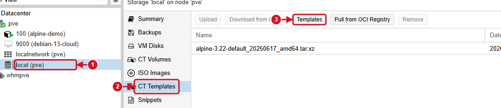

### KVM 虚拟机

1. 下载 amd64 KVM 镜像并核对 SHA-256。下例使用 Debian 13，把镜像放到 PVE 节点的 `/var/tmp/debian-13-cloudinit-qga_kvm-amd64.qcow2`。 [镜像下载目录](https://github.com/hajidishu/whmpve/tree/main/templates)
2. 在 PVE Shell 执行以下命令。用空闲 VMID 替换 `9000`，按需替换 `vmbr1` 和 `local-lvm`。选用 Alpine 时，替换镜像文件名并使用 SeaBIOS。

```sh
qm create 9000 --name debian-13-cloud --memory 1024 --net0 virtio,bridge=vmbr1 --scsihw virtio-scsi-pci
qm set 9000 --scsi0 local-lvm:0,import-from=/var/tmp/debian-13-cloudinit-qga_kvm-amd64.qcow2
qm set 9000 --ide2 local-lvm:cloudinit --boot order=scsi0 --serial0 socket --agent enabled=1
qm template 9000
```

3. 将模板的克隆权限分别授予用户和令牌。每个 KVM 模板执行一次。

```sh
pveum acl modify /vms/9000 --users whmpve@pve --roles PVETemplateUser
pveum acl modify /vms/9000 --tokens 'whmpve@pve!whmcs' --roles PVETemplateUser
```

4. 记下 PVE 左侧模板条目中显示的 VMID，例如 `9000`。KVM Plan 的系统盘不能小于模板磁盘。项目提供的 KVM 镜像已预装 Cloud-Init 和 QEMU Guest Agent，Debian 镜像也已包含数据盘挂载所需的软件包。 [Proxmox Cloud-Init 文档](https://github.com/proxmox/pve-docs/blob/master/qm-cloud-init.adoc)

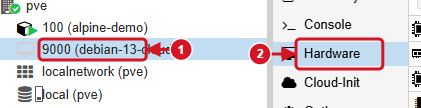

## 4. 安装并启用 WHMPVE

1. 解压 WHMPVE 安装包，把 `modules/` 和 `includes/` 合并到 WHMCS 根目录，也就是 `configuration.php` 所在的目录。确认下面三个文件已上传。

   ```text
   modules/addons/whmpve_manager/whmpve_manager.php
   modules/servers/whmpve/whmpve.php
   includes/hooks/whmpve.php
   ```

2. 进入「配置 → 系统设置 → 附加模块」，在 WHMPVE 一行点「启用（Activate）」。点击「配置（Configure）」，勾选允许使用的管理员角色，例如「Full Administrator」，保存。 [WHMCS 启用附加模块](https://docs.whmcs.com/9-1/addon-modules/addon-modules/#activate-an-addon-module)

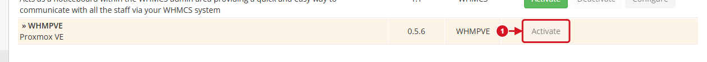


3. 进入「系统设置 → 自动化设置（Automation Settings）」，复制页面顶部给出的 Cron 命令。用站点兼容的 PHP CLI，以站点运行用户每 5 分钟执行一次。已有 WHMCS Cron 时，在「自动化状态」确认它近期正常运行。 [WHMCS Cron 设置](https://docs.whmcs.com/9-1/system/automation/system-cron/)

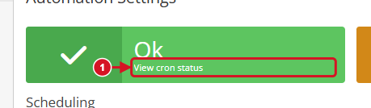

## 5. 在 WHMPVE 添加服务器

1. 打开「附加模块 → WHMPVE → 服务器」，点「添加服务器」。


2. 填写下表并保存，然后在该服务器一行点「检测」，确认显示「连接成功，备份权限正常」。

| 字段 | 示例 |
| --- | --- |
| 名称 | `PVE 东京 01` |
| PVE 地址 | `pve1.example.net`，只填主机名 |
| API 令牌 ID / API 密钥 | `whmpve@pve!whmcs` / 生成令牌时保存的密钥 |
| PVE 节点 | `pve`，按 PVE 左侧节点名称填写 |
| 默认存储名称 / 备份存储名称 | `local-lvm` / `local` |
| 权限池（PVE Pool） | `whmpve` |
| CA 证书路径（可选） | PVE 使用默认签发证书时填 `/etc/whmpve/pve-root-ca.pem` |

需要 VPS 随 PVE 宿主机启动时，勾选「宿主机开机时自动启动 VPS」。切换后，等待 WHMCS Cron 同步该服务器已有的 VPS。PVE API 使用其他端口时，在「高级设置」修改「API 端口」。


## 6. 添加镜像和 IP 池

1. 点服务器名称进入配置，再点「镜像 → 添加镜像」。填客户看到的名称、类型和第 3 步记录的卷名或 KVM 模板 VMID，设置最低内存和磁盘，保存。


2. 回到「附加模块 → WHMPVE → 服务器」，点刚添加的服务器名称，进入该服务器的管理页。

   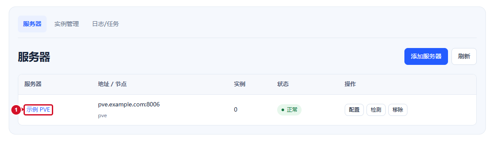

3. 点击「IP 池」，点「创建 IP 池」。IPv4 和 IPv6 各建一个池。双栈先填一个并保存，再从这里创建另一个。

   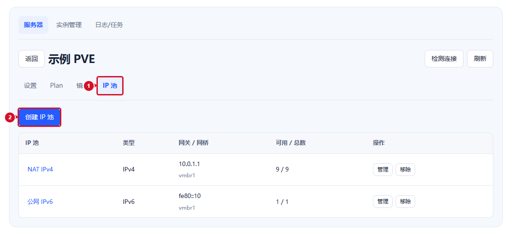

4. 按启用的网络填写下表。IPv4 选「起始与结束地址」，分别填两栏。IPv6 选「手动添加」，把已在宿主机配置路由和代理的公网地址逐行贴进「IP 地址」，每行只填地址。点右下角的「保存」，回到 IP 池列表确认可用地址数量。

   | 字段 | IPv4 NAT 池 | IPv6 公网池 |
   | --- | --- | --- |
   | 名称 | `NAT IPv4` | `公网 IPv6` |
   | 地址类型 | `IPv4` | `IPv6` |
   | 前缀长度 | `24` | `128` |
   | 网关 | `10.0.1.1` | `fe80::10` |
   | 网桥 | `vmbr1` | `vmbr1` |
   | VLAN | 留空 | 留空 |
   | DNS | `1.1.1.1` | `2606:4700:4700::1111` |
   | MTU | `1500` | `1500` |
   | 新增地址 | 「起始与结束地址」，`10.0.1.2` 到 `10.0.1.10` | 「手动添加」，如 `2001:db8:1234:5678::103` |

   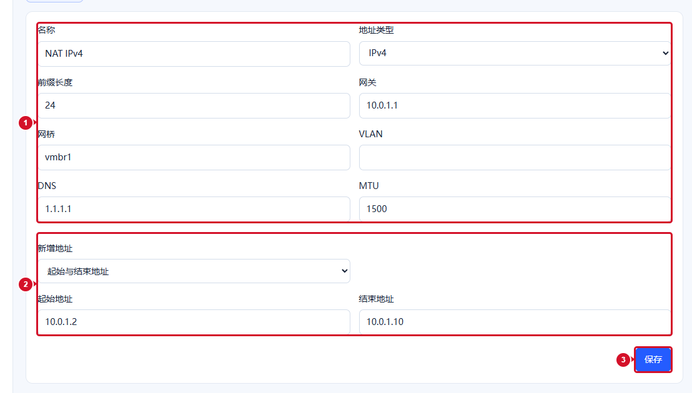

   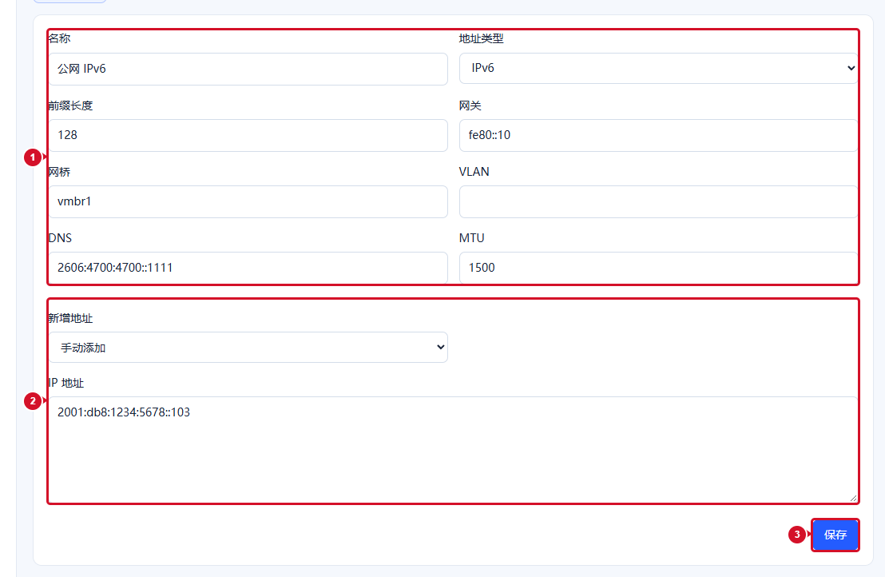

   配图中的公网 IPv6 要换成你的实际地址。池的「前缀长度」`128` 会作为掩码下发给 VPS。WHMPVE 开通时会创建 VPS 网卡并接到池里指定的网桥。本例 LXC 使用 `eth0`，KVM 使用 `net0`（VirtIO），KVM 的地址和网关通过 Cloud-Init 下发。使用「生成 IPv6」时，也要先为生成的地址配好路由和 Proxy NDP，再开放地址池。

## 7. 创建 Plan

1. 在该服务器的「Plan」页点「新建 Plan」。选镜像对应的虚拟化类型，填写核数、内存、系统盘大小和 PVE 存储名。Alpine 测试可以用 1 核、256 MiB、2 GiB。

   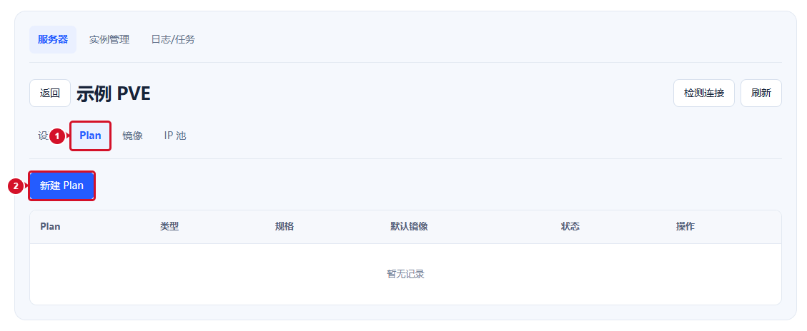

   

2. 找到「IP 池」，点右边的下拉箭头，勾选刚创建的池。IPv4 NAT 勾选 `NAT IPv4`，公网 IPv6 勾选 `公网 IPv6`。双栈两项都勾选，看到两个标签后点击箭头收起列表。在「IPv4 数量」「IPv6 数量」各填 `1`，只使用一个协议时，另一个数量填 `0`。

   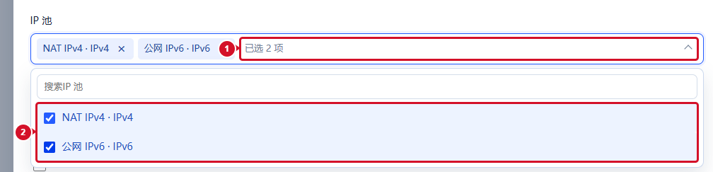

   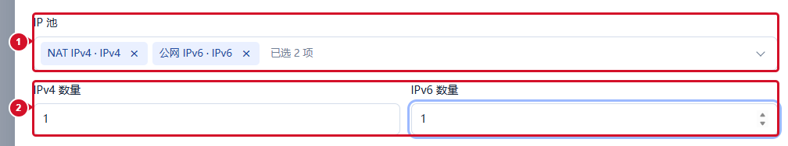

3. 按需填带宽和月流量额度，填 `0` 为不限。需要备份时，设置「最多备份数」。允许客户自行开自动备份时，勾选「允许客户启用自动备份」。
4. 使用 IPv4 NAT 时，勾选「分配的是内网地址」。展开后，在「公网入口 IP」填宿主机公网 IPv4，在「分配的端口」粘贴下列两行。这个字段给客户展示连接信息，转发规则在第 1 步配置。仅使用公网 IPv6 时跳过本步。

   ```text
   SSH（TCP）：6[ipv4_3][ipv4_4:03]
   可用端口（TCP / UDP）：[ipv4_3][ipv4_4:03]0-[ipv4_3][ipv4_4:03]9
   ```

   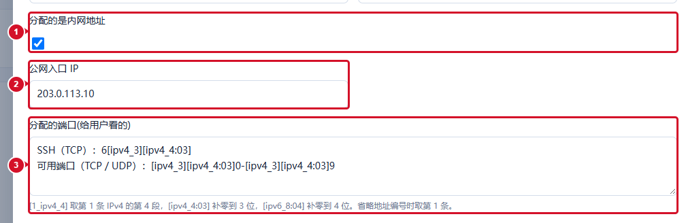

   `[ipv4_3]` 取第一条 IPv4 的第三段，`[ipv4_4:03]` 把第四段补齐为三位。`10.0.1.3` 显示 SSH 端口 `61003` 和可用端口 `10030–10039`。SSH 映射到 VPS 的 `22`，端口段映射到 VPS 内相同的端口。公网 IPv6 可直接连接 VPS 地址和服务端口。

5. 滚动到 Plan 底部，选择「默认镜像」，点右下角的「保存」。

   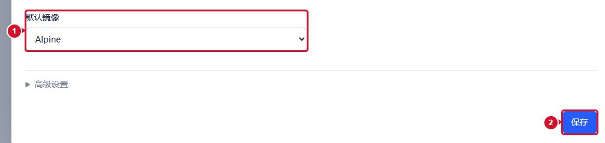

## 8. 创建 WHMCS 产品并验证开通

1. 打开「系统设置 → 产品/服务」。首次创建时先点「创建新组（Create a New Group）」，再点「创建新产品（Create a New Product）」。类型选「Server/VPS」，填写产品名称并选择该组。

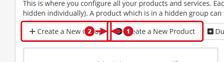
2. 在「定价」设置金额和账期。在「模块设置（Module Settings）」选择 `WHMPVE`，再选刚创建的服务器和 Plan。测试自动开通时，选「收到首笔付款后自动开通」，保存更改。


3. 需要发送交付邮件时，在产品的「详细信息」里选择「欢迎邮件」模板。异步开通完成后，由 WHMCS Cron 发送这封邮件。
4. 使用已启用的支付方式创建一笔测试订单并完成支付。需要测试线下入账时，可在 WHMCS 启用「Bank Transfer」，用测试客户下单，再在对应账单点「Add Payment」登记测试付款。
5. 打开「附加模块 → WHMPVE → 日志/任务」确认开通成功，再到「实例管理」点击「管理」。在 PVE 核对这台实例的运行状态、IP 和磁盘。用测试客户账号打开服务详情，检查电源操作和任务状态。配置了欢迎邮件的产品也要检查邮件日志。
6. 登录测试客户账号，进入「服务 → 我的服务」（有的主题显示「我的产品与服务」），点击刚开通的 VPS。在 VPS 面板点「网络」，核对地址和网关。记录 IPv4 NAT 的公网入口 IP 和 SSH 端口。双栈示例的「内网 IPv6」一栏显示的是分给该 VPS 的公网 IPv6，连接时使用 `/128` 前面的地址。

   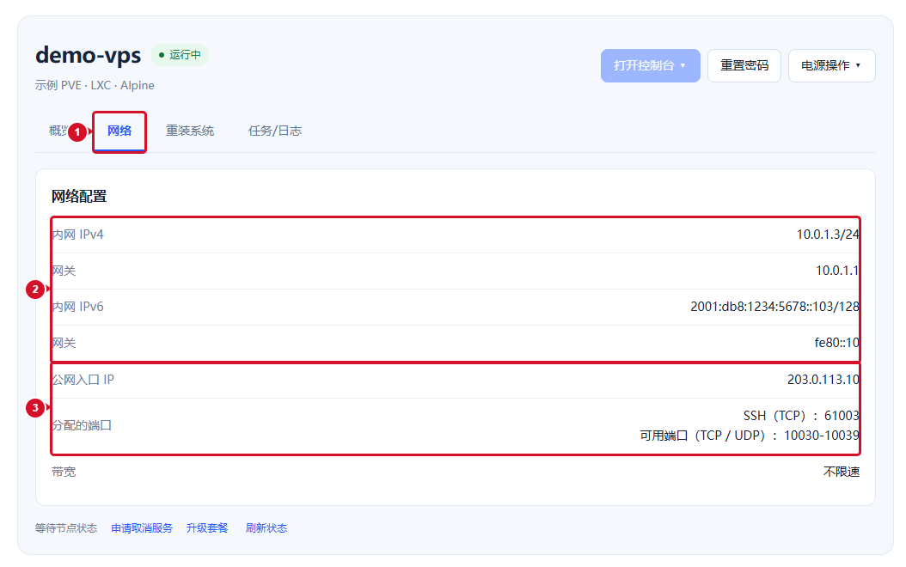

7. 在 VPS 内测试出站。用 LXC 示例时，在 PVE 宿主机 Shell 执行 `pct list` 查到刚开通容器的 VMID，再用 `pct enter 100` 进入，把 `100` 换成该 VMID。IPv4 运行 `ping -c 3 1.1.1.1`，IPv6 运行 `ping -6 -c 3 2606:4700:4700::1111`。再运行 `nslookup example.com`，确认能查到地址。启动 VPS 内的 SSH 服务并放行端口，从另一台有公网连接的机器测试入站。假设 IPv4 分到 `10.0.1.3`，用 `ssh -p 61003 USER@203.0.113.10`。IPv6 用 `ssh -6 USER@2001:db8:1234:5678::103`。换成实际地址和账号，用实际客户端验收开放的 TCP 或 UDP 服务端口。

KVM 加购 CPU 或内存后，按客户区「附加服务」的提示重新启动 VPS。

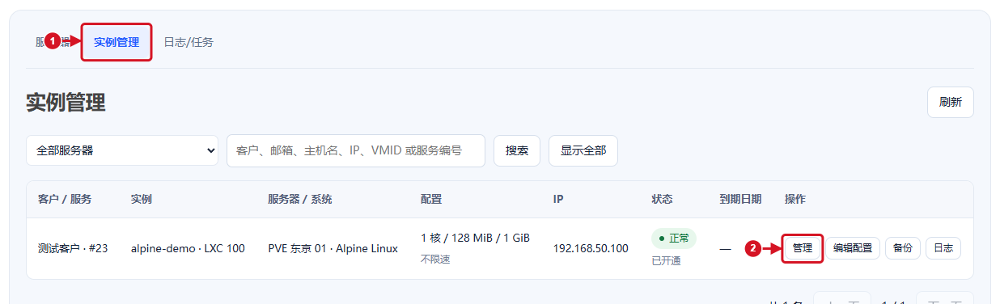

## 9. 按需开启网页控制台

任选一份部署指南。

- [Python 网页控制台中继](console-python.md)
- [Nginx 网页控制台中继](console-nginx.md)
- [Apache2 网页控制台中继](console-apache2.md)
